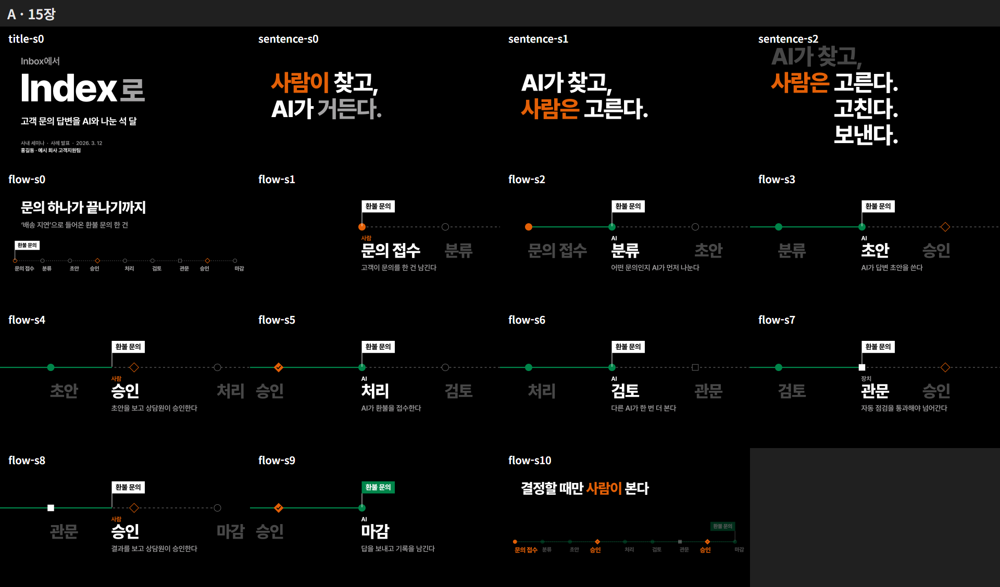

# motion-graphic

말로 하는 발표를 **모션그래픽 슬라이드**로 만드는 Claude Code 스킬(`motion-deck`)입니다. 결과물은 인터넷 없이 더블클릭으로 열리는 **HTML 파일 하나**입니다.

- 발표자가 앞에서 말하고 화면이 뒤에서 돕는 발표에 씁니다. 보고서·제안서처럼 읽는 문서는 만들지 않습니다.
- 결과물 HTML 안에 CSS·JS·폰트·이미지가 모두 들어 있습니다.
  - 발표 조작: `→`·`←` 진행 · `S` 발표자 노트 · `P` 일시정지 · `F` 전체 화면
- 실제 사내 컨퍼런스 발표(33장)를 만들면서 다듬은 과정을 그대로 스킬로 옮겼습니다.

## 스타일 세 가지

| A 「무대」 | B 「지면」 | C 「색면과 도형」 |
|---|---|---|
|  |  |  |
| 검정 무대에 한 번에 하나만 불을 켭니다. 큰 글자가 움직이며 말하고 카메라가 따라갑니다. | 흰 지면 위에 글이 조판되고, 사람은 주황 펜으로 고칩니다. | ◆ 사람 · ● AI · ■ 장치 세 도형이 배우처럼 연기하고, 글자는 자막입니다. |

움직이는 미리보기는 `skills/motion-deck/styles/<A|B|C>/preview.html` 을 내려받아 더블클릭한 뒤 `→` 로 넘겨 보면 됩니다.

## 진행 순서
1. **브리프**: 준 자료를 먼저 읽고 빈칸(주제·청중·시간)만 묻습니다.
2. **스타일 고르기**
3. **장 목록**: 한 번만 승인받습니다.
4. **제작**: 끝까지 만듭니다.
   - 가장 어려운 장면부터 만듭니다.
   - Herdr 안에서 돌리면 챕터를 pane에 나눠 병렬로 만듭니다.
5. **검사**
   - 빌드: 금칙어·외부 참조·서체 검사
   - 헤드리스 Chrome 캡처: 글자 크기·겹침·대비·외부 요청
   - 모션 필름
   - 단일 파일 `file://` 검증: 발표자 보기 키 전달까지
6. **납품**: 단일 HTML, 타이밍표, 사용자 확인이 필요한 목록

## 필요한 것
- Claude Code
- Node.js 22 이상: 스크립트가 내장 `WebSocket`·`fetch` 를 씁니다. npm 설치는 필요 없습니다.
- Chrome·Edge·Chromium 중 하나: 자동으로 찾고, 못 찾으면 `CHROME_PATH` 를 씁니다.
- 선택
  - Herdr: 병렬 제작
  - Codex CLI: 사진·일러스트가 꼭 필요할 때
- Windows에서 만들고 검증했습니다.

## 설치

### 플러그인으로 (권장)
```bash
claude plugin marketplace add bigbulgogiburger/motion-graphic
claude plugin install motion-graphic@motion-graphic
```
- 부르기: `/motion-graphic:motion-deck 발표 주제 · 자료 폴더 · 요청`
- 업데이트: `claude plugin update motion-graphic` 후 Claude Code를 다시 시작합니다.

### 스킬 폴더만 복사해서
`skills/motion-deck` 폴더를 `~/.claude/skills/motion-deck` 에 복사합니다.
- 부르기: `/motion-deck 발표 주제 · 자료 폴더 · 요청`

이 스킬은 직접 부를 때만 동작합니다(`disable-model-invocation`).

## 구성

| 경로(`skills/motion-deck/` 아래) | 내용 |
|---|---|
| `SKILL.md` | 진행 여섯 단계와 지켜야 할 것 |
| `references/` | rules(말투·글자·색·모션·"AI 느낌" 목록) · engine(무대 엔진) · tools(검사) · parallel(Herdr) · images · new-style |
| `styles/A·B·C/` | 디자인 시스템(DESIGN.md·theme) · 샘플 3장 · 미리보기 · 스크린샷 |
| `scripts/` | new-deck · build · capture · sheet · verify · timing (Node 스크립트, Playwright 없음) |
| `engine/` · `vendor/reveal/` · `fonts/` | 빌드가 넣는 무대 엔진 · reveal.js · Pretendard |
| `templates/` | 브리프·장 목록·진행·타이밍 양식 |

## Codex에서 쓰기
Codex 판은 [bigbulgogiburger/motion-graphic-codex](https://github.com/bigbulgogiburger/motion-graphic-codex) 에 있습니다.

## 라이선스
- 이 저장소: MIT
- 동봉한 것
  - reveal.js: MIT, `skills/motion-deck/vendor/reveal/LICENSE`
  - Pretendard: SIL OFL 1.1, `skills/motion-deck/fonts/LICENSE.txt`
